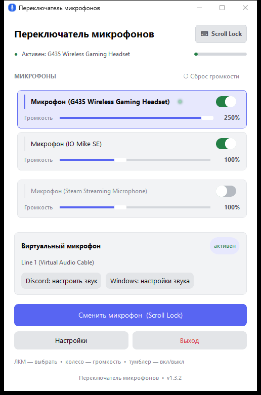

# MicSwitcher — переключатель микрофонов

[Русский](#переключатель-микрофонов) · [English](#micswitcher-mic-switcher)


Портативное приложение — папка `MicSwitcher` с `MicSwitcher.exe` внутри, —
которое мгновенно переключает микрофон «по умолчанию» по горячей клавише.
Работает и с виртуальным микрофоном (Virtual Audio Cable): удобно, когда в
Discord/Zoom уже настроен виртуальный вход и перестраивать его не нужно.

**Версия:** 1.3.2 · **Платформа:** Windows 10/11 · **Python не требуется**

## Возможности

- ⌨️ **Переключение по горячей клавише** — дефолтный микрофон меняется одним нажатием
- 🎧 **Виртуальный микрофон для Discord** — звук автоматически роутится в VAC, вход в Discord не меняется
- 🔊 **Громкость каждого микрофона** (0–250%, колесо мыши) + сброс в один клик
- ✖ **Исключение микрофонов** из переключения (правый клик или тумблер на карточке)
- 🎨 **Интерфейс в стиле Discord** — палитры Dark / Light / Midnight, blurple-акцент, карточки и тумблеры как в клиенте
- 🪞 **Авто-тема «как в Discord»** — приложение снимает цвета с окна запущенного Discord, поэтому подхватывает даже клиентские темы (например, «Пепел») и перекрашивается, когда тему меняют
- 🔔 **Трей-иконка** — сворачивается в трей, иконка закрепляется в видимой области, повторный запуск поднимает окно
- 🚀 **Автозапуск** при входе в Windows
- 🌐 **Два языка**: русский и английский
- 🧯 **Один экземпляр**: повторный запуск не создаёт второй процесс и двойные горячие клавиши
- 📄 **Отладочный лог**: `micswitcher_debug.log` рядом с exe (в `%TEMP%`, если папка недоступна)



## Установка

1. Скачайте архив **`MicSwitcher-v1.3.2.zip`** со страницы [Releases](https://github.com/xffliner/mic-switcher/releases) и распакуйте его
2. Запустите `MicSwitcher.exe` из папки `MicSwitcher`. **Python не нужен.** Все файлы папки — единый комплект (сборка `onedir`: приложение не распаковывается в `%TEMP%` и не требует прав администратора)
3. Первый запуск создаёт рядом с exe файл настроек `mic_switcher.json`

## Виртуальный микрофон (для Discord)

Чтобы звук с переключаемого микрофона шёл в Discord через виртуальный вход,
нужен драйвер **Virtual Audio Cable**:

1. Установите VAC ([vb-audio.com](https://vb-audio.com/Cable/))
2. В приложении появится статус **«VAC: Line 1 (Virtual Audio Cable) · активен»**
3. В Discord → Настройки → Голос и видео → Устройство ввода: **Line 1 (Virtual Audio Cable)**

Схема: `физический микрофон → MicSwitcher (роутер) → VAC → Discord`

Без VAC программа просто переключает системный микрофон «по умолчанию».

## Как пользоваться

| Действие | Что делает |
|---|---|
| Горячая клавиша (по умолчанию **F9**) | Переключить дефолтный микрофон |
| ЛКМ по микрофону в списке | Выбрать его сразу |
| Колесо мыши над карточкой | Громкость микрофона (0–250%) |
| Тумблер на карточке | Вкл/выкл участие микрофона в переключении |
| **Правый клик** по микрофону | То же, что тумблер |
| Кнопка **«Сменить микрофон»** | То же, что горячая клавиша |
| Крестик окна | Свернуть в трей (программа продолжает работать) |
| Иконка в трее → «Выход» | Завершить программу |

## Горячая клавиша

**Настройки → Горячая клавиша → поле с клавишей → нажать нужную клавишу**
(Esc — отмена). Форматы: `f10`, `f12`, `ctrl+m`, `alt+f1`, `shift+f5`,
`scroll lock`, `caps lock`, `num lock`, `pg up`, `home`, `insert`, `delete`,
`print screen` и т.п.

## Оформление и темы

**Настройки → Оформление**:

- **Авто — как в Discord** — снимает реальные цвета с окна Discord (фон + панели) и строит из них палитру. Работает с любыми темами клиента, в том числе клиентскими («Пепел» и др.) и с пользовательскими цветами. Пока окно Discord открыто, тема перепроверяется каждые 5 секунд; если окно свернули — приложение остаётся в снятых цветах
- **Discord Dark / Discord Light / Discord Midnight** — фиксированные пресеты

## Файлы рядом с exe

- `mic_switcher.json` — горячая клавиша, исключения, громкости, язык, «поверх окон»
- `micswitcher_ui.json` — режим оформления (например, `{"theme_mode": "auto"}`)
- `micswitcher_debug.log` — отладочный лог

## Сборка из исходников

Нужен Python 3.10+ (Windows):

```bash
pip install -r requirements.txt
python build_exe.py        # PyInstaller onedir -> dist/MicSwitcher/
```

Структура:

- `mic_switcher.py` — аудио-логика: устройства, дефолт, роутинг VAC, горячая клавиша, конфиг
- `mic_switcher_modern.py` — UI (CustomTkinter) и точка входа
- `build_exe.py` — сборка портативной папки `MicSwitcher\` (иконка вшивается в код)
- `test_poll_hotkey.py`, `test_tray.py` — регрессионные проверки хоткея и трея

## История версий

- **1.3.2** — авто-тема не перекрашивает интерфейс в мусорные цвета, если окно Discord перекрыто; чтение конфигов с BOM; чистка кода
- **1.3.1** — убрана метка «исключён» (состояние видно по тумблеру); исправлено падение при ошибке теста VAC; пересборка UI по теме выполняется в главном потоке
- **1.3.0** — авто-тема по фактическим цветам окна Discord (клиентские темы)
- **1.2.0** — темы Dark / Light / Midnight, авто-подхват из данных Discord
- **1.1.x** — интерфейс в стиле Discord: селекты, тумблеры, кнопки, поля
- **1.0.4** — исправлен хоткей (флаг из очереди не доходил до переключения)
- **1.0.3** — иконка в трее, подъём окна при повторном запуске

## Лицензия

[MIT](LICENSE)

---

# MicSwitcher — Mic Switcher

A portable app — the `MicSwitcher` folder with `MicSwitcher.exe` inside —
that instantly switches the system default microphone with a hotkey.
It also routes audio into a Virtual Audio Cable (VAC), so your
Discord/Zoom virtual-mic input keeps working.

**Version:** 1.3.2 · **Platform:** Windows 10/11 · **No Python required**

## Features

- ⌨️ **Hotkey switching** — one press changes the default mic
- 🎧 **Virtual mic for Discord** — audio is routed into VAC automatically
- 🔊 **Per-mic volume** (0–250%, mouse wheel) + one-click reset
- ✖ **Exclude mics** from rotation (right-click or the card toggle)
- 🎨 **Discord-style UI** — Dark / Light / Midnight palettes, blurple accent, Discord-like cards and switches
- 🪞 **Auto theme "follow Discord"** — samples the real colors of the running Discord window, so client themes (e.g. "Ash") and custom colors are picked up as well
- 🔔 **Tray icon** — minimizes to tray, the icon is pinned to the visible area, relaunching raises the window
- 🚀 **Autostart** with Windows
- 🌐 **Two languages**: Russian and English
- 🧯 **Single instance**: relaunching never creates a second process
- 📄 **Debug log**: `micswitcher_debug.log` next to the exe (falls back to `%TEMP%`)

## Installation

1. Download **`MicSwitcher-v1.3.2.zip`** from [Releases](https://github.com/xffliner/mic-switcher/releases) and extract it
2. Run `MicSwitcher.exe` from the `MicSwitcher` folder. **No Python required.** Keep all files of the folder together (onedir build: the app never unpacks itself into `%TEMP%` and needs no admin rights)
3. The first run creates `mic_switcher.json` next to the exe

## Virtual mic (for Discord)

You need the **Virtual Audio Cable** driver:

1. Install VAC ([vb-audio.com](https://vb-audio.com/Cable/))
2. The app shows **«VAC: Line 1 (Virtual Audio Cable) · активен» / active**
3. Discord → Settings → Voice & Video → Input Device: **Line 1 (Virtual Audio Cable)**

Pipeline: `physical mic → MicSwitcher (router) → VAC → Discord`

Without VAC the app simply switches the system default mic.

## Usage

| Action | Effect |
|---|---|
| Hotkey (default **F9**) | Switch default mic |
| LMB on a mic card | Select it immediately |
| Mouse wheel over a card | Volume (0–250%) |
| Card toggle | Enable/disable the mic in rotation |
| Right-click on a mic | Same as the toggle |
| Window close button | Hide to tray (app keeps running) |
| Tray icon → Exit | Quit |

## Appearance and themes

**Settings → Appearance**: *Auto — follow Discord* (samples the real Discord window colors every 5 s), plus fixed **Discord Dark / Light / Midnight** presets.

## Building from source

Python 3.10+ (Windows):

```bash
pip install -r requirements.txt
python build_exe.py        # PyInstaller onedir -> dist/MicSwitcher/
```

## Changelog

- **1.3.2** — auto theme no longer applies garbage colors when the Discord window is covered; BOM-tolerant config reading; code cleanup
- **1.3.1** — removed the "excluded" badge (state is shown by the toggle); fixed the VAC test crash on error; theme rebuild runs in the main thread
- **1.3.0** — auto theme from real Discord window colors (client themes)
- **1.2.0** — Dark / Light / Midnight themes with auto-detection from Discord data
- **1.1.x** — Discord-style widgets: selects, switches, buttons, fields
- **1.0.4** — fixed the hotkey flag never reaching the switch
- **1.0.3** — tray icon, raising the window on relaunch

## License

[MIT](LICENSE)
