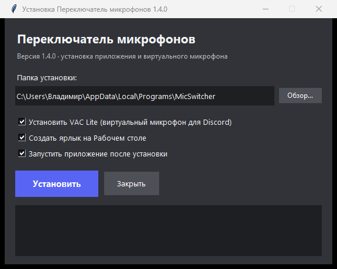

# MicSwitcher — переключатель микрофонов

[Русский](#переключатель-микрофонов) · [English](#micswitcher-mic-switcher)

Переключает микрофон «по умолчанию» в Windows одним нажатием клавиши и умеет
роутить звук в виртуальный микрофон для Discord. Интерфейс — в стиле Discord
с четырьмя темами клиента.

**Версия 1.4.0** · Windows 10/11 · Python не нужен


## Что скачать

| Файл | Для чего |
|---|---|
| **`MicSwitcher-Setup-1.4.0.exe`** ⭐ | **Установщик (рекомендуется).** Ставит приложение в `%LOCALAPPDATA%\Programs\MicSwitcher`, при желании — **VAC Lite** (драйвер виртуального микрофона), создаёт ярлык на Рабочем столе и в меню «Пуск», добавляет запись в «Программы и компоненты» с деинсталлятором |
| `MicSwitcher-1.4.0.exe` | **Портативная версия.** Один exe, без установки. Запустить и пользоваться; настройки хранятся рядом с файлом |
| `VAC-Lite.zip` | **Virtual Audio Cable Lite** — драйвер виртуального микрофона (Line 1). Нужен только если хотите, чтобы Discord слышал переключённый микрофон через виртуальный вход |



## Установка

### Вариант 1 — установщик (рекомендуется)

1. Скачайте **`MicSwitcher-Setup-1.4.0.exe`** и запустите
2. Отметьте нужное:
   - **Установить VAC Lite** — драйвер виртуального микрофона (потребуются права администратора, после установки драйвера может понадобиться перезагрузка);
   - **Создать ярлык на Рабочем столе**;
   - **Запустить приложение после установки**
3. Нажмите **«Установить»**

Всё ставится в пользовательскую папку, права администратора нужны только для драйвера VAC.
Удалить можно через «Параметры → Приложения» или `uninstall.bat` в папке установки.

### Вариант 2 — портативно

Скачайте **`MicSwitcher-1.4.0.exe`** и запустите из любой папки. Настройки (`mic_switcher.json`)
создаются рядом с exe, поэтому папку лучше держать в постоянном месте.

## Виртуальный микрофон (VAC Lite)

Нужен, если вы хотите переключать микрофон, а в Discord/Zoom устройство ввода чтобы не менялось:

1. Установите **VAC Lite** (кнопкой в установщике или вручную из `VAC-Lite.zip` → `setup64.exe`)
2. В приложении появится статус **«VAC: Line 1 (Virtual Audio Cable) · активен»**
3. В Discord → Настройки → Голос и видео → Устройство ввода выберите **Line 1 (Virtual Audio Cable)**

Схема: `физический микрофон → MicSwitcher (роутер) → VAC → Discord`

Без VAC программа просто переключает системный микрофон «по умолчанию».

## Как пользоваться

| Действие | Что делает |
|---|---|
| Горячая клавиша (по умолчанию **F9**) | Переключить микрофон по умолчанию |
| ЛКМ по карточке микрофона | Выбрать его сразу |
| Колесо мыши над карточкой | Громкость микрофона (0–250%) |
| Тумблер на карточке | Вкл/выкл участие микрофона в переключении |
| Правый клик по микрофону | То же, что тумблер |
| Кнопка **«Сменить микрофон»** | То же, что горячая клавиша |
| Крестик окна | Свернуть в трей (программа работает) |
| Иконка в трее → «Выход» | Завершить программу |

**Горячая клавиша меняется** в Настройках: нажмите на поле с клавишей и нажмите нужную
(Esc — отмена). Поддерживаются `f10`, `ctrl+m`, `alt+f1`, `scroll lock`, `caps lock`, `pg up` и т.п.

## Темы

**Настройки → Оформление** — четыре темы Discord, как в клиенте:

- **Discord Светлая**, **Discord Тёмная**, **Discord Пепел**, **Discord Чёрная**
- **Авто — как в Discord** — при запуске приложение один раз смотрит, какая тема выбрана в
  Discord (по окну клиента, а если оно свёрнуто — по данным клиента), и включает такую же.
  Если тема не распознана или Discord не установлен — **Discord Тёмная**


Ручной выбор запоминается; в авто-режиме тема больше не меняется на ходу.

## Файлы рядом с приложением

- `mic_switcher.json` — горячая клавиша, исключения, громкости, язык, «поверх окон»
- `micswitcher_ui.json` — режим оформления
- `micswitcher_debug.log` — отладочный лог (запуск, переключения, ошибки)

Удаление конфига сбрасывает настройки к значениям по умолчанию.

## Сборка из исходников

Python 3.10+ (Windows):

```bash
pip install -r requirements.txt
python build_exe.py        # приложение (onedir) → dist/MicSwitcher/
```

Файлы проекта:

- `mic_switcher.py` — аудио-логика: устройства, дефолт, роутинг VAC, горячая клавиша, конфиг
- `mic_switcher_modern.py` — интерфейс (CustomTkinter) и точка входа
- `installer.py` — установщик (собирается PyInstaller'ом вместе с папкой приложения и VAC)
- `build_exe.py` — сборка папки приложения
- `test_poll_hotkey.py`, `test_tray.py` — регрессионные проверки

## История версий

- **1.4.0** — три варианта поставки (установщик, портативный exe, VAC Lite); четыре темы Discord (Светлая, Тёмная, Пепел, Чёрная); авто-тема определяется один раз при запуске; список устройств вывода обновляется при открытии и больше не залипает на «—»
- **1.3.3** — починена рамка карточек в настройках (линия за скруглёнными углами)
- **1.3.2** — устойчивость авто-темы и чтения конфигов (BOM), чистка кода
- **1.3.1** — убрана метка «исключён», исправлено падение при ошибке теста VAC, пересборка UI в главном потоке
- **1.3.0** — авто-тема по фактическим цветам окна Discord
- **1.2.0** — темы Dark / Light / Midnight, авто-подхват из данных Discord
- **1.1.x** — интерфейс в стиле Discord: селекты, тумблеры, кнопки, поля
- **1.0.4** — исправлен хоткей
- **1.0.3** — иконка в трее, подъём окна при повторном запуске

## Лицензия

[MIT](LICENSE)

---

# MicSwitcher — Mic Switcher

Switches the Windows default microphone with a single hotkey and can route
audio into a virtual microphone for Discord. Discord-style UI with four client themes.

**Version 1.4.0** · Windows 10/11 · No Python required

## Downloads

| File | Purpose |
|---|---|
| **`MicSwitcher-Setup-1.4.0.exe`** ⭐ | **Installer (recommended).** Installs to `%LOCALAPPDATA%\Programs\MicSwitcher`, optionally installs **VAC Lite**, creates Desktop and Start-menu shortcuts, registers an uninstaller |
| `MicSwitcher-1.4.0.exe` | **Portable.** A single exe, no installation; settings are stored next to the file |
| `VAC-Lite.zip` | **Virtual Audio Cable Lite** driver (Line 1) — only needed for the virtual-mic routing in Discord |

## Install

1. Run **`MicSwitcher-Setup-1.4.0.exe`**
2. Tick what you need: install VAC Lite (admin rights, reboot may be required), create a desktop shortcut, launch after install
3. Press **Install** — the app goes into your user profile; admin rights are needed only for the VAC driver

Portable alternative: run **`MicSwitcher-1.4.0.exe`** from any folder.

## Virtual mic (VAC Lite)

1. Install **VAC Lite** (`setup64.exe`)
2. The app shows **«VAC: Line 1 (Virtual Audio Cable) · активен» / active**
3. Discord → Settings → Voice & Video → Input Device: **Line 1 (Virtual Audio Cable)**

Pipeline: `physical mic → MicSwitcher (router) → VAC → Discord`

## Usage

| Action | Effect |
|---|---|
| Hotkey (default **F9**) | Switch the default mic |
| LMB on a mic card | Select it |
| Mouse wheel over a card | Volume (0–250%) |
| Card toggle / right-click | Enable/disable the mic in rotation |
| Window close button | Hide to tray |
| Tray icon → Exit | Quit |

## Themes

**Settings → Appearance**: four Discord themes — **Light**, **Dark**, **Ash**, **Black** — plus
**Auto — follow Discord**, checked once at startup (window color, or client data if the window is
minimized). Unknown theme or no Discord → **Discord Dark**.

## Files next to the app

`mic_switcher.json` (settings), `micswitcher_ui.json` (theme mode), `micswitcher_debug.log` (log).

## Build from source

```bash
pip install -r requirements.txt
python build_exe.py        # app (onedir) → dist/MicSwitcher/
```

## Changelog

- **1.4.0** — three download options (installer, portable exe, VAC Lite); four Discord themes (Light, Dark, Ash, Black); auto theme detected once at startup; the output-device list refreshes on open and no longer sticks at "—"
- **1.3.3** — fixed the card border artifact in Settings
- **1.3.2** — robustness of the auto theme and configs (BOM), cleanup
- **1.3.1** — removed the "excluded" badge, fixed the VAC test crash, theme rebuild in the main thread
- **1.3.0** — auto theme from the real Discord window colors
- **1.2.0** — Dark / Light / Midnight themes with auto-detection
- **1.1.x** — Discord-style widgets
- **1.0.4** — hotkey fix
- **1.0.3** — tray icon, raise window on relaunch

## License

[MIT](LICENSE)
