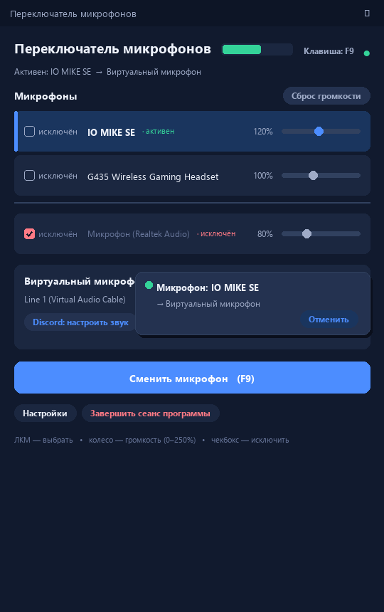

# Переключатель микрофонов (MicSwitcher)

Лёгкое приложение для Windows. Одна горячая клавиша переключает активный
микрофон — **и системный «по умолчанию», и «виртуальный» для Discord**
(через Virtual Audio Cable). Не нужно перенастраивать Discord после каждого
переключения: звук с выбранного микрофона автоматически течёт в виртуальный
кабель, а в Discord достаточно один раз выбрать вход *Virtual Audio Cable*.

| | |
|---|---|
| **Платформа** | Windows 10 / 11 |
| **Язык** | Python 3.10+ |
| **UI** | CustomTkinter |
| **Лицензия** | [MIT](LICENSE) |

## Возможности

- 🔁 Переключение микрофонов по горячей клавише (по умолчанию **F9**)
- 🎧 Виртуальный микрофон для Discord через **Virtual Audio Cable**
- 📡 Индикация заряда беспроводных наушников (Bluetooth / Logitech G HUB / WMI)
- 🚫 Правый клик по микрофону — исключить его из ротации
- 🔔 Всплывающие уведомления о текущем микрофоне
- 🖥 Иконка в системном трее, окно можно свернуть
- ⚙️ Настройка горячей клавиши прямо в приложении
- 🔒 Single-instance: повторный запуск не создаёт второй экземпляр

## Скриншот



## Схема работы

```
физический микрофон ──► (роутер в программе) ──► Virtual Audio Cable (Line 1) ──► Discord
```

## Установка из исходников

Требуется Python 3.10+.

```bash
# 1. Клонируем
git clone https://github.com/<ваш-логин>/mic-switcher.git
cd mic-switcher

# 2. Виртуальное окружение (рекомендуется)
python -m venv .venv
.venv\Scripts\activate          # Windows
# source .venv/bin/activate     # macOS / Linux

# 3. Зависимости
pip install -r requirements.txt

# 4. Запуск
python mic_switcher_modern.py
```

## Сборка одного exe-файла

```bash
pip install pyinstaller
python build_exe.py
# результат: dist/MicSwitcher.exe
```

`build_exe.py` вшивает иконку в код и собирает полностью автономный
one-file / windowed-исполняемый файл (PyInstaller).

## Virtual Audio Cable (опционально)

Виртуальный микрофон для Discord требует драйвер
[Virtual Audio Cable](https://vb-audio.com/Cable/). **Без него** приложение
работает как обычный переключатель системного микрофона «по умолчанию».
После установки VAC в окне появляется строка «✅ Виртуальный микрофон: готов».

## Горячая клавиша

Поддерживаемые форматы: `f10`, `f12`, `ctrl+m`, `alt+f1`, `shift+f5`,
`scroll lock`, `caps lock`, `num lock`, `pg up`, `pg dn`, `home`, `end`,
`insert`, `delete`, `print screen` и т.п. Пробелы допустимы
(`scroll lock` = `scrolllock`).

## Настройки

Исключения микрофонов и горячая клавиша сохраняются в `mic_switcher.json`
рядом с exe. Удалите файл, чтобы сбросить настройки.

## Автозапуск (по желанию)

`Win+R` → `shell:startup` → Enter, создайте там ярлык на exe.

## Структура проекта

| Файл | Назначение |
|---|---|
| [`mic_switcher.py`](mic_switcher.py) | Аудио-логика: список устройств, дефолт, роутинг VAC, горячая клавиша |
| [`mic_switcher_modern.py`](mic_switcher_modern.py) | UI (CustomTkinter) и точка входа |
| [`battery.py`](battery.py) | Модуль заряда: Bluetooth / G HUB / WMI + фоновый монитор |
| [`build_exe.py`](build_exe.py) | Сборка одного exe (PyInstaller) |
| [`MicSwitcher.spec`](MicSwitcher.spec) | Конфиг PyInstaller |
| [`requirements.txt`](requirements.txt) | Зависимости |

## Лицензия

[MIT](LICENSE).
